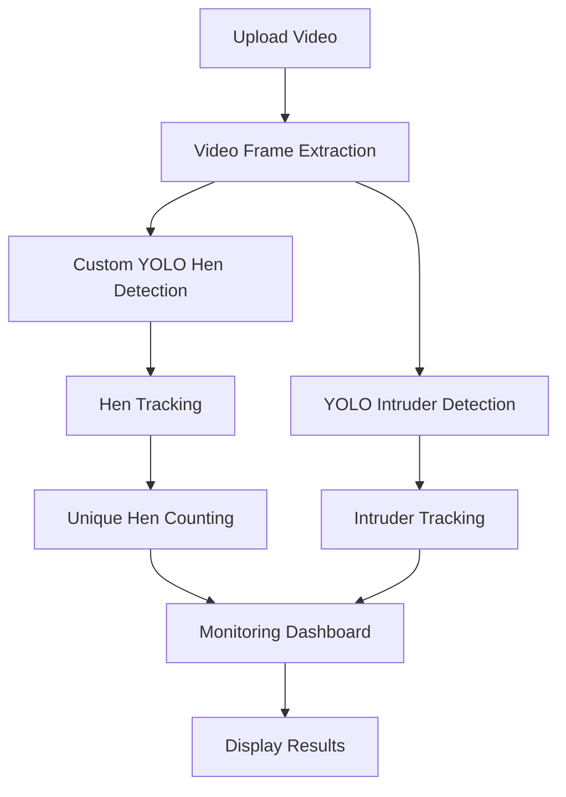

# 🐔 AI-Based Poultry Farm Monitoring System
### Automated Hen Counting & Intruder Detection Using Computer Vision

<p align="center">
  <b>An AI-powered computer vision application for poultry farm monitoring, hen counting and potential intruder detection using YOLO object detection and tracking.</b>
</p>

<p align="center">
  <a href="https://gpzd2mfzchwmgcnryzknjr.streamlit.app/">🚀 LIVE DEMO</a> •
  <a href="https://github.com/Manu701970/AI_Based-Poultry-Farm-Monitoring-Hen-Counting-and-Intruder-Detection-System-">📂 SOURCE CODE</a>
</p>

---

## 🚀 Live Application

### 👉 [OPEN THE LIVE AI POULTRY MONITORING APPLICATION](https://gpzd2mfzchwmgcnryzknjr.streamlit.app/)

Upload a video and use the web application to detect, track and count hens and identify potential intruders.

---

## 📌 Project Overview

Traditional poultry farm monitoring often requires manual observation to monitor birds and identify potential threats.

This project introduces an AI-based poultry monitoring system built using computer vision and YOLO object detection. The application processes uploaded videos, identifies hens, tracks individual detections using tracking IDs, counts unique hens and detects potential intruders.

The application provides a Streamlit dashboard where users can upload videos, configure detection settings and view monitoring results.

## ✨ Key Features

- 🐔 **AI-Based Hen Detection** – Detect hens in video frames using a custom-trained YOLO model.
- 🔢 **Unique Hen Counting** – Track individual hens using tracking IDs to estimate the number of unique hens detected.
- 🚨 **Intruder Detection** – Detect potential intruders, including animals and people supported by the object detection model.
- 🎥 **Video-Based Monitoring** – Upload video files and process them using computer vision.
- 📊 **Monitoring Dashboard** – View detection statistics, tracking information and processing results.
- ⚙️ **Adjustable Detection Settings** – Configure confidence and detection thresholds.
- 📥 **Processed Results** – View and download the processed monitoring output when supported by the application.
- ☁️ **Web Deployment** – Access the application online without installing the project locally.

## 🖥️ Application Preview

<p align="center">
  <a href="https://gpzd2mfzchwmgcnryzknjr.streamlit.app/">
    
  </a>
</p>

> Visit the live application to view the monitoring dashboard and upload a video.

## 🧠 System Architecture



## 🔄 Working Process

1. **Video Input** – The user uploads a video through the Streamlit application.
2. **Frame Extraction** – The uploaded video is processed frame by frame.
3. **Hen Detection** – The custom-trained YOLO model identifies hens.
4. **Hen Tracking** – Tracking algorithms assign and maintain tracking IDs across frames.
5. **Hen Counting** – Unique tracking IDs are used to estimate the number of hens detected.
6. **Intruder Detection** – A YOLO object detection model identifies supported potential intruder classes.
7. **Result Visualization** – Detection and tracking results are presented through the monitoring dashboard.

## 🛠️ Technologies Used

| Technology | Purpose |
|---|---|
| Python | Core programming language |
| Ultralytics YOLO | Object detection and tracking |
| OpenCV | Video processing and image handling |
| Streamlit | Web application and dashboard |
| NumPy | Numerical operations |
| Pandas | Data processing |

## 🤖 AI Models

### Hen Detection Model
- Custom-trained YOLO model.
- Used to identify hens in video frames.
- Tracking is used to estimate unique hen counts.

### Intruder Detection Model
- YOLOv8n pretrained object detection model.
- Detects supported objects from the pretrained model's classes.
- Tracking is used to monitor detections across video frames.

## 📂 Project Structure

```text
AI-Based-Poultry-Farm-Monitoring/
│
├── app.py
├── hen_best.pt
├── yolov8n.pt
├── requirements.txt
├── train_model.py
├── README.md
└── .gitignore
```

## ⚙️ Installation and Setup

Run the project locally if you want to use it on your computer.

### Step 1: Clone the repository

```bash
git clone https://github.com/Manu701970/AI_Based-Poultry-Farm-Monitoring-Hen-Counting-and-Intruder-Detection-System-.git
```

### Step 2: Navigate to the project directory

```bash
cd AI_Based-Poultry-Farm-Monitoring-Hen-Counting-and-Intruder-Detection-System-
```

### Step 3: Install dependencies

```bash
pip install -r requirements.txt
```

### Step 4: Launch the application

```bash
streamlit run app.py
```

The application will open in your local browser.

## 📦 Requirements

- Python
- Internet connection for initial dependency installation
- Required Python packages listed in `requirements.txt`
- Video files supported by the application

## 🎯 Project Objectives

- Automate hen detection and counting.
- Reduce manual poultry farm monitoring.
- Detect potential intruders through computer vision.
- Apply AI-based object detection and tracking to agricultural monitoring.
- Develop an accessible web-based monitoring application.

## 🔮 Future Enhancements

- Real-time monitoring using CCTV cameras.
- Improved counting accuracy in crowded environments.
- Poultry movement and activity analysis.
- Automatic alert notifications for detected intruders.
- Poultry health and abnormal behavior monitoring.
- Database integration for historical monitoring records.
- Farm-level monitoring analytics.

## ⚠️ Limitations

- Counting accuracy depends on video quality, lighting and visibility.
- Tracking IDs may change when objects overlap, disappear or re-enter the frame.
- Intruder detection depends on the pretrained model's supported classes.
- The application is designed for video-based monitoring and does not guarantee perfect detection.
- Cloud processing is subject to hosting platform resource and file upload limits.

## 🌐 Project Links

| Resource | Link |
|---|---|
| 🚀 Live Application | [Open Live App](https://gpzd2mfzchwmgcnryzknjr.streamlit.app/) |
| 📂 GitHub Repository | [View Source Code](https://github.com/Manu701970/AI_Based-Poultry-Farm-Monitoring-Hen-Counting-and-Intruder-Detection-System-) |

---

<p align="center">
  <b>AI-Powered Poultry Monitoring Using Computer Vision</b>
</p>

<p align="center">
  Developed using Python, YOLO, OpenCV and Streamlit.
</p>
